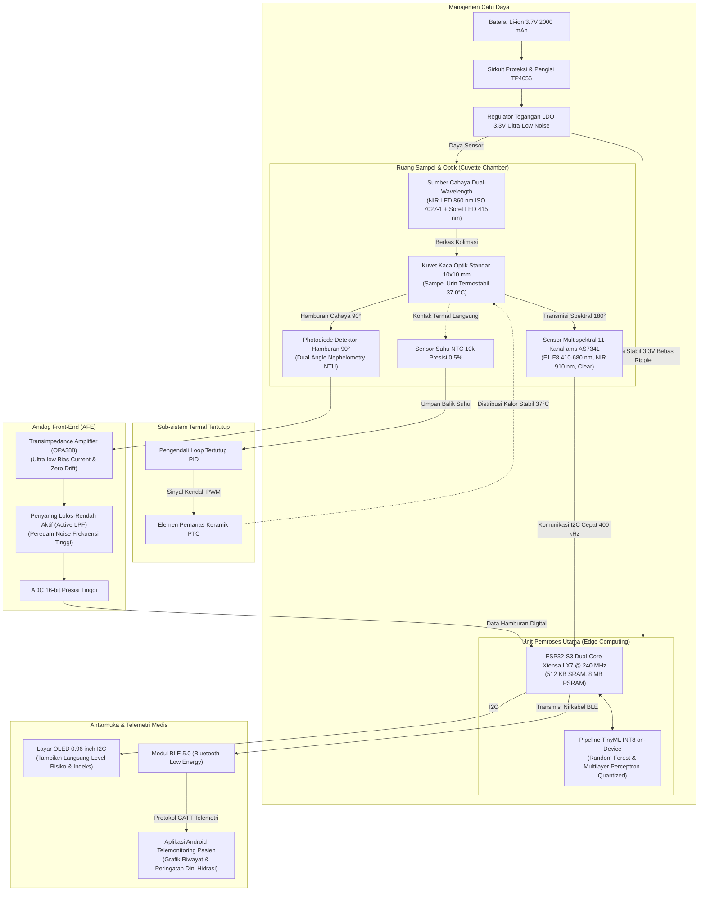
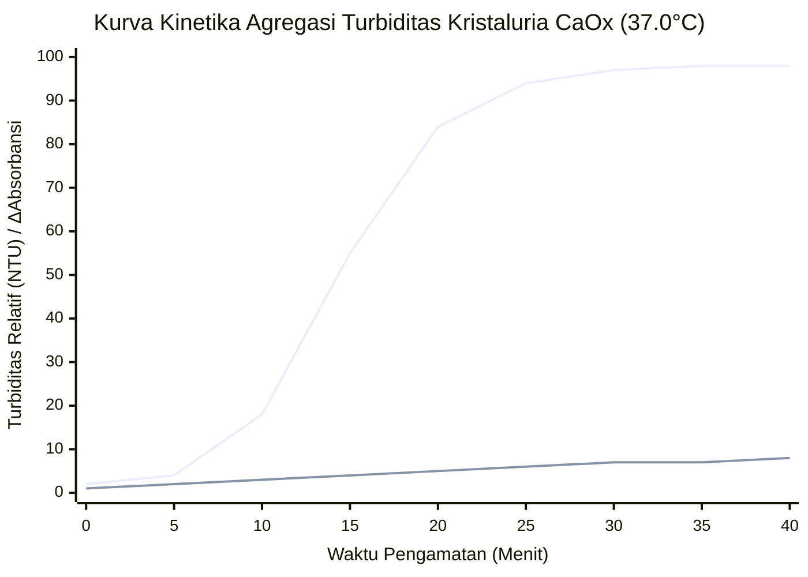
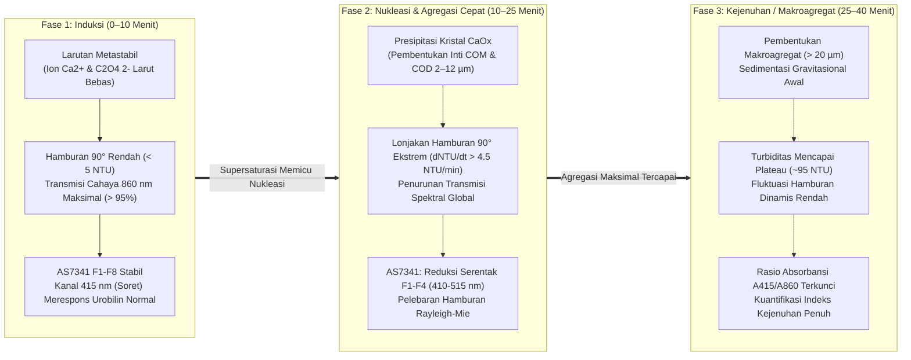

# DIAGRAM MERMAID RESMI PROPOSAL PKM-KC LITHOSCAN 2026

Dokumen ini memuat seluruh kode diagram Mermaid resmi untuk proposal PKM-KC LITHOSCAN:
1. **Gambar 1.1** Diagram Blok Konseptual Instrumen LITHOSCAN
2. **Gambar 2.1A** Kurva Kinetika Agregasi Turbiditas CaOx (`xychart-beta`)
3. **Gambar 2.1B** Mekanisme Kinetika Agregasi dan Respon Spektroskopi AS7341 (`flowchart LR`)
4. **Gambar 3.1** Diagram Alir Tahapan Pelaksanaan Enjiniring LITHOSCAN (`flowchart TD`)
5. **Gambar 3.2** Arsitektur Pipeline TinyML INT8 on-Device ESP32-S3 (`flowchart TD`)

---

## 1. Gambar 1.1 Diagram Blok Konseptual Instrumen LITHOSCAN

Diagram ini menggambarkan interkoneksi perangkat keras, optik, pengondisi sinyal analog, komputasi tepi (*edge AI*), dan antarmuka pengguna pada sistem LITHOSCAN.



---

## 2. Gambar 2.1 Kurva Kinetika Agregasi Turbiditas CaOx dan Respon Spektroskopi AS7341

### 2.1A Kurva Kinetika Agregasi Turbiditas (Chart)

Kurva ini merepresentasikan tiga fase utama kristaluria kalsium oksalat: Fase Induksi (*nucleation latency*), Fase Pertumbuhan & Agregasi Eksponensial, dan Fase Saturasi (*plateau*).



### 2.1B Alur Respon Spektral Sensor AS7341 terhadap Fase Kinetika

Diagram alur komplementer yang memperlihatkan bagaimana kanal spektral AS7341 merespons dinamika pembentukan kristal:



---

## 3. Gambar 3.1 Diagram Alir Tahapan Pelaksanaan Enjiniring LITHOSCAN

Alur metodologi 4 tahapan rekayasa teknik sistem yang terstruktur selama 4 bulan pelaksanaan PKM-KC:

```mermaid
flowchart TD
    START(["Mulai Pelaksanaan PKM-KC LITHOSCAN"]) --> T1

    subgraph T1["Tahap 1: Perancangan & Fabrikasi Hardware (Bulan 1)"]
        direction TB
        T1_1["Pemodelan 3D Optical Flow Cell & Thermal Chamber di CAD"]
        T1_2["Fabrikasi Enclosure Presisi Menggunakan 3D Printing PETG Hitam"]
        T1_3["Perakitan Rangkaian Pengkondisi Sinyal TIA OPA388 & LED Driver"]
        T1_4["Integrasi Pemanas PTC & Pengendali PID Suhu 37.0°C ± 0.2°C"]
        T1_1 --> T1_2 --> T1_3 --> T1_4
    end

    T1 --> GATE1{"Uji Stabilitas Suhu & Noise Optik Lolos?"}
    GATE1 -- "Tidak (Drift > 0.5°C atau SNR < 40 dB)" --> T1
    GATE1 -- "Ya (Suhu Stabil 37°C & SNR Optik Tinggi)" --> T2

    subgraph T2["Tahap 2: Pengembangan Algoritma TinyML & Firmware (Bulan 2)"]
        direction TB
        T2_1["Akuisisi Dataset Respons 11-Kanal Spektral & 90° Hamburan Urin Sintetis"]
        T2_2["Ekstraksi Fitur: Laju Perubahan Turbiditas (dNTU/dt), Rasio Spektral, AUC"]
        T2_3["Pelatihan Model Random Forest & Multilayer Perceptron di Python"]
        T2_4["Kuantisasi Model ke Fixed-Point INT8 Menggunakan TF Lite Micro"]
        T2_5["Deployment Engine TinyML ke SRAM ESP32-S3 & Optimasi Latensi (<100 ms)"]
        T2_1 --> T2_2 --> T2_3 --> T2_4 --> T2_5
    end

    T2 --> GATE2{"Akurasi Model TinyML INT8 > 90% & Memory < 64 KB?"}
    GATE2 -- "Tidak (Akurasi Rendah / Out of Memory)" --> T2
    GATE2 -- "Ya (Akurasi Terverifikasi & Ringan)" --> T3

    subgraph T3["Tahap 3: Karakterisasi & Validasi Laboratorium Urin Sintetis (Bulan 3)"]
        direction TB
        T3_1["Formulasi Urin Sintetis Standar ASTM dengan Variasi Ca2+ & Oksalat"]
        T3_2["Pengujian Rentang Deteksi Dinamis Turbiditas (0.1 s.d. 100 NTU)"]
        T3_3["Evaluasi Interferensi Warna & Hematuria menggunakan Kanal Soret 415 nm"]
        T3_4["Validasi Komparatif dengan Spektrofotometer UV-Vis Benchtop Laboratorium"]
        T3_1 --> T3_2 --> T3_3 --> T3_4
    end

    T3 --> GATE3{"Korelasi Spektrofotometer R² > 0.95 & CV < 5%?"}
    GATE3 -- "Tidak (Linearitas Kurang Memadai)" --> T3
    GATE3 -- "Ya (Presisi & Sensitivitas Terbukti)" --> T4

    subgraph T4["Tahap 4: Integrasi Sistem, Telemetri & Evaluasi Komparatif (Bulan 4)"]
        direction TB
        T4_1["Integrasi Komunikasi Nirkabel BLE 5.0 ke Aplikasi Mobile Android"]
        T4_2["Pengujian Ketahanan Sistem & Konsumsi Daya Baterai Li-ion"]
        T4_3["Uji Perbandingan Kinerja vs Strip Celup Kimiawi (Dipstick)"]
        T4_4["Penyusunan Dokumentasi Teknis, Manual Pengguna, & Naskah Publikasi"]
        T4_1 --> T4_2 --> T4_3 --> T4_4
    end

    T4 --> DONE(["Prototipe Fungsional LITHOSCAN Siap Uji & Selesai"])
```



---

## 4. Gambar 3.2 Arsitektur Pipeline TinyML INT8 on-Device ESP32-S3

Arsitektur komputasi tepi (*edge inference*) yang beroperasi secara mandiri tanpa memerlukan ketergantungan koneksi internet (*zero-cloud dependency*):

```mermaid
flowchart TD
    subgraph INPUT_LAYER["1. Input Data Sensor Mentah (Multisensor Array)"]
        direction LR
        S_SPEC["Spektrometer AS7341\n(8 Kanal Visual F1-F8, NIR 910 nm, Clear)"]
        S_NEPH["Detektor Nefelometri 90°\n(Hamburan Partikel Cahaya NIR 860 nm)"]
        S_TEMP["Sensor Suhu NTC 10k\n(Verifikasi Suhu Fisiologis 37.0°C)"]
    end

    subgraph PREPROCESSING["2. Pengondisi Sinyal & Ekstraksi Fitur (On-Device MCU)"]
        direction TB
        PRE_1["Kompensasi Arus Gelap (Dark-Current Subtraction)"]
        PRE_2["Kalibrasi Offset & Normalisasi Vektor Min-Max"]
        PRE_3["Ekstraksi Fitur Temporal & Spektral:"]
        FEAT_A["Fitur 1: Kemiringan Laju Agregasi Kristal dNTU/dt"]
        FEAT_B["Fitur 2: Indeks Rasio Spektral Soret Band (A415 / A680)"]
        FEAT_C["Fitur 3: Total Area Bawah Kurva (AUC Turbiditas)"]
        
        PRE_1 --> PRE_2 --> PRE_3
        PRE_3 --> FEAT_A & FEAT_B & FEAT_C
    end

    INPUT_LAYER -->|Sampling Frekuensi 10 Hz| PREPROCESSING

    subgraph TINYML_ENGINE["3. Mesin Inferensi TinyML INT8 (ESP32-S3 SRAM)"]
        direction TB
        QUANT["Kuantisasi Penuh Post-Training INT8 (TF Lite Micro)\n(Reduksi Ukuran Bobot Model 75% Tanpa Penurunan Akurasi)"]
        MODEL["Ensemble Model:\n- Quantized Random Forest Classifier\n- Compact Multilayer Perceptron (MLP INT8)"]
        OPT["Akselerasi Instruksi Vektor SIMD ESP-NN\n(Waktu Inferensi < 45 ms, Alokasi RAM < 48 KB)"]
        
        QUANT --> MODEL --> OPT
    end

    FEAT_A & FEAT_B & FEAT_C -->|Vektor Fitur Ternormalisasi [1x12]| TINYML_ENGINE

    subgraph OUTPUT_LAYER["4. Klasifikasi Indeks Risiko Litogenik & Aksi"]
        direction TB
        DECISION{"Batas Keputusan Inferensi (Decision Boundary)"}
        
        CAT_LOW["Level 1: RISIKO RENDAH (Normal)\nIndeks Kejenuhan Stabil, Bebas Kristaluria Akut\n-> Rekomendasi: Pertahankan Asupan Cairan Normal"]
        CAT_MED["Level 2: RISIKO SEDANG (Waspada)\nNukleasi Awal Terdeteksi, Laju Agregasi Moderat\n-> Peringatan: Tingkatkan Hidrasi 500 mL Segera"]
        CAT_HIGH["Level 3: RISIKO TINGGI (Kritis)\nAgregasi Masif CaOx + Hematuria Mikroskopis\n-> Tindakan: Intervensi Hidrasi Intensif & Evaluasi Medis"]
        
        DECISION -->|Skor < 0.35| CAT_LOW
        DECISION -->|0.35 <= Skor <= 0.70| CAT_MED
        DECISION -->|Skor > 0.70| CAT_HIGH
    end

    TINYML_ENGINE --> DECISION

    subgraph SYSTEM_ACTUATION["5. Luaran Sistem"]
        direction LR
        DISP["Visualisasi OLED 0.96 inch"]
        TELE["Transmisi Telemetri BLE 5.0"]
        LOG["Penyimpanan Log Flash Medis"]
    end

    CAT_LOW & CAT_MED & CAT_HIGH --> DISP & TELE & LOG
```

---

## 5. Panduan Cara Meng-generate Menjadi Gambar

Untuk mengubah kode Mermaid di atas menjadi berkas gambar PNG/SVG beresolusi tinggi (300 DPI) untuk disisipkan ke berkas Word:

1. **Mermaid Live Editor (Paling Cepat & Gratis)**:
   - Buka peramban ke [https://mermaid.live/](https://mermaid.live/).
   - Salin salah satu blok kode di atas (mulai dari `flowchart ...` atau `xychart-beta ...`).
   - Tempel pada panel editor di sebelah kiri.
   - Klik tombol **Download** di kanan bawah, lalu pilih **PNG** (pilih resolusi tinggi) atau **SVG**.
2. **VS Code Extension**:
   - Pasang ekstensi *Markdown Preview Mermaid Support*.
   - Buka dokumen markdown ini, klik kanan diagram, lalu pilih *Export Mermaid Diagram as PNG/SVG*.
3. **Mermaid CLI (`@mermaid-js/mermaid-cli`)**:
   - Jika memiliki Node.js, jalankan perintah terminal:
     ```bash
     npx @mermaid-js/mermaid-cli -i input.mmd -o Gambar1-1.png -b transparent -s 3
     ```
     (Flag `-s 3` memberikan skala 3x resolusi tajam/kualitas cetak standar publikasi ilmiah).
